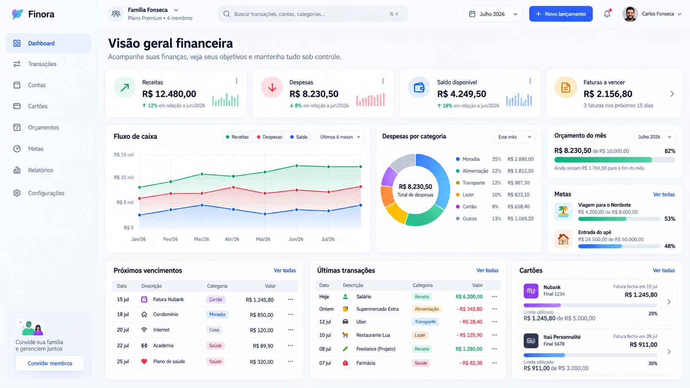
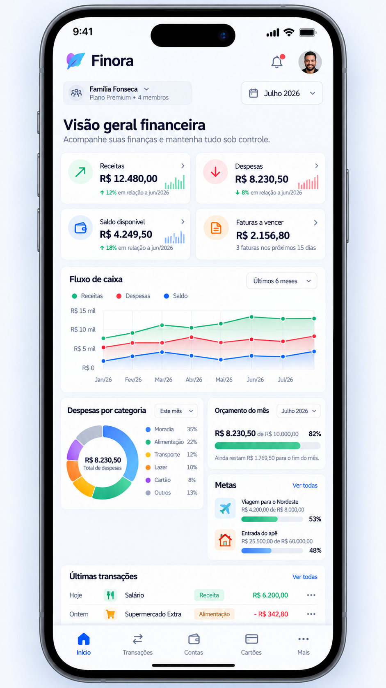

# FINANCE SaaS — Documentação Mestra do Produto e Engenharia

**Versão:** 1.0 (baseline de planejamento)  
**Data:** 09/10/2026  
**Estado:** especificação para implementação; nenhum módulo é considerado implementado  
**Nome:** provisório, **não** utilizar “Finora” como decisão de branding  
**Idioma inicial:** pt-BR | **Plataforma:** 100% web responsiva | **Banco:** Supabase/PostgreSQL

> **Instrução para Codex:** este documento é a fonte de verdade funcional/técnica inicial. Não assuma que telas, schemas, código ou componentes dos mockups existem. Antes de cada tarefa, leia as seções relevantes, implemente a menor mudança coesa, gere migration/testes, execute validações e reporte resultado. Questões listadas como “em aberto” não devem ser inventadas silenciosamente.

## 1. Objetivo e escopo

Construir um SaaS de finanças para pessoas, casais, famílias e pequenas equipes, com um espaço (tenant) isolado por cliente, múltiplos membros e gestão de receitas, despesas, contas, cartões, parcelas, recorrências, orçamentos, reservas, metas, fluxo de caixa e relatórios. A experiência será exclusivamente pelo navegador, em desktop, tablet, iPhone e Android — sem dependência de aplicativo nativo, Flutter ou React Native. PWA instalável pode ser evolutivo, mas o produto deve operar plenamente sem instalação.

**Objetivos:** eliminar manutenção manual de planilhas; reduzir lançamentos duplicados; centralizar histórico; garantir consistência financeira; permitir autoatendimento e monetização Free/Premium; priorizar qualidade em telas estreitas.

**Fora do MVP:** Open Banking automático, conexão bancária, pagamentos de contas, integração PIX, investimentos, emissão fiscal, contabilidade fiscal empresarial, consolidação cambial, OCR automático, recomendações de IA, app mobile nativo, hierarquia corporativa/centros de custo sofisticados. Não prometer integração com bancos nem custódia de recursos.

**Perfis:** proprietário individual; casal/família com responsabilidades compartilhadas; pequeno grupo com permissões; operador da plataforma somente para suporte técnico e assinatura.

**Módulos do produto completo:** (1) autenticação/onboarding; (2) tenants/membros; (3) dashboard; (4) transações; (5) contas; (6) categorias e pessoas; (7) orçamento/planejamento; (8) cartões/faturas/parcelas; (9) recorrências; (10) metas/reservas; (11) fluxo/relatórios; (12) anexos/importação; (13) planos/cobrança; (14) painel SaaS/auditoria.

## 2. Tarefas de definição — FIN-001 a FIN-005

### FIN-001 — Definir requisitos e personas | P0 | Produto
**Objetivo:** transformar a planilha em casos de uso claros, cobrindo gestão individual, familiar e pequena equipe.

**Entregáveis:** lista de funcionalidades e exclusões; personas e jornadas (criar conta → tenant → conta financeira → primeira receita/despesa → dashboard; convite → membro); mapa de menus; matriz de requisitos funcionais e não funcionais; glossário; histórias prioritárias e critérios de aceite.

**Critérios de aceite:** (a) usuário novo consegue entender como criar um espaço financeiro; (b) especificação contempla separação por tenant e participação em múltiplos tenants; (c) fluxo de receita, despesa, transferência, cartão e reserva foi descrito; (d) mobile-first e acessibilidade são requisitos; (e) requisitos incertos foram registrados como decisões pendentes.

### FIN-002 — Definir regras financeiras | P0 | Backend + Produto
**Objetivo:** documentar sem ambiguidade tipos de movimentos, caixa/competência, pagamentos, estornos, reservas, benefícios, cartão e projeções.

**Entregáveis:** regras RF-001 a RF-025 (seção 4); exemplos numéricos; definição das métricas; cenários de testes; critérios de importação da planilha; política de datas, arredondamento e integridade.

**Critérios de aceite:** nenhuma transferência/aporte altera o resultado de consumo; compra no cartão e pagamento de fatura não duplicam gasto; realizado não é sinônimo de previsto; testes cobrem pagamento parcial, estorno e transferência; há tratamento explícito para benefícios VA/VR.

### FIN-003 — Desenhar modelo multi-tenant | P0 | Backend + Banco
**Objetivo:** tenants, memberships, RBAC e isolamento real com RLS.

**Entregáveis:** ERD lógico (seção 7); migrations; constraints com tenant_id; políticas de RLS; matriz de papéis; convites; troca de tenant; testes adversariais A/B; política de acesso administrativo.

**Critérios de aceite:** um usuário de tenant A não lê ou modifica recursos do tenant B mesmo alterando IDs/URLs; operações exigem membership ativo; login não implica permissão; um usuário pode ser membro de mais de um tenant; deleção/saída preserva trilha de auditoria.

### FIN-004 — Design system e UX base | P1 | UX + Frontend
**Objetivo:** formalizar identidade visual e responsividade dos mockups, mantendo-os apenas como referências (não designs pixel-perfect).

**Entregáveis:** tokens, tipografia, cores e semântica, grid e breakpoints, navegação desktop/tablet/mobile, componentes e estados, acessibilidade WCAG 2.2 AA como meta, regras de densidade e consistência de valores.

**Critérios de aceite:** todas as rotas essenciais funcionam a partir de 320 px sem rolagem horizontal; tabelas se convertem em listas/cartões no mobile; inputs e botões são utilizáveis ao toque; contraste/foco/teclado; tema light/dark; a dashboard não usa dois painéis financeiros apertados lado a lado em smartphone.

### FIN-005 — Definir planos e limites SaaS | P1 | Produto + SaaS
**Objetivo:** oferecer somente Free e Premium, com regras de entitlement no servidor.

**Entregáveis:** matriz de planos (seção 9); lifecycle trial/assinatura; regras de upgrade/downgrade; limite por tenant; política de bloqueio sem perda de dados; testes de autorização e webhook.

**Critérios de aceite:** a UI exibe recursos bloqueados de modo compreensível; limites são validados no backend e em operações SQL críticas; pagamento duplicado não altera assinatura duas vezes; downgrade não apaga dados; acesso de leitura é preservado conforme política.

## 3. Inventário da planilha e decisões de migração

**Fonte analisada:** `7 - Julho - Copia.xlsx`, 11 abas. **Não usar os mockups como fonte de valores reais**; seus números são ilustrativos.

| Aba | Conteúdo observado | Destino no SaaS |
|---|---|---|
| Configurações | Formas de pagamento, categorias, receitas, responsáveis, classificação e cenário | Catálogos por tenant e enums funcionais |
| Receitas | Projetado/realizado, tipo de receita, responsável, observação | Income transactions + expected amount |
| Despesas | Projetado/realizado, parcela, forma, classificação, pago | Despesas, pagamentos, orçamentos e recorrências |
| Fatura CC | Fatura projetada/realizada, cartão e pagamento | Compras, parcelas, faturas e pagamentos |
| Reserva CC / Reserva CC (2) | Dinheiro reservado para faturas | Contas de reserva / alocações, sem duplicar gasto |
| Objetivos_Gastos | Distribuição ideal/real de fixas, pessoais e poupança | Regras de planejamento e dashboard |
| Análise | Consolidações por pagamento e categoria | Views e relatórios derivados |
| Fluxo_Caixa | Receitas e despesas projetadas/realizadas | Fluxo de caixa derivado de operações |
| Planilha3 / Planilha4 | Tabelas auxiliares | Sem entidades próprias; substituir por consultas |

**Observações efetivamente constatadas:** `Receitas` apresenta quatro entradas e total realizado de **R$ 9.675,83** (salários R$ 8.525,83 + benefícios R$ 1.150,00). Aba `Análise` reporta despesas realizadas em torno de **R$ 8.829,68**, sob a classificação da planilha; esse número é uma referência para auditoria, **não** saldo bancário reconciliado. `Objetivos_Gastos` traz metas ideais de **60% fixas, 25% poupança, 15% pessoais**. A linha “Despesas pessoais — Real” parece repetir a porcentagem de despesas fixas (**77,283%**) e requer revisão. As versões de `Reserva CC` exibem valores realizados diferentes (R$ 3.527,90 e R$ 6.405,24); investigar proveniência antes de importar. `Fatura CC` aponta previsto R$ 2.885,79 versus realizado R$ 4.281,32, diferença que precisa de conciliação.

**Não inferir:** saldos iniciais, datas de transação individual, taxa de câmbio, periodicidade de parcelas e lastro das reservas não estão adequadamente demonstrados em todas as abas. Importar somente dados válidos, com revisão humana para campos incertos.

**Fluxo de importação:** carregar arquivo temporário → identificar aba e linha → normalizar números pt-BR, categorias e nomes → identificar pagamentos/cartões/benefícios → detectar duplicidades com chave de origem → apresentar prévia e divergências → confirmar em transação → registrar import_batch/import_row, origem, hash e operador → reconciliar totais. Falha de importação não pode deixar importação parcial oculta.

## 4. Regras financeiras (contrato funcional)

**Vocabulário:** transação é um fato ou obrigação financeira; pagamento é sua liquidação; transferência é movimentação interna; compra no cartão gera obrigação; aporte em meta realoca patrimônio; categoria é classificação de consumo; responsável é atribuição analítica, não titularidade da conta.

**RF-001 — Unidade de conta:** cada conta financeira pertence a um tenant, tem moeda ISO 4217, saldo inicial com data-base e status (ativa/arquivada). Saldo atual = saldo inicial + entradas confirmadas - saídas confirmadas. Saldos não são fonte de verdade paralela.

**RF-002 — Representação monetária:** PostgreSQL `NUMERIC(19,4)` ou representação equivalente exata; arredondar para a menor unidade da moeda ao liquidar; valores exibidos via `Intl.NumberFormat`; proibido float em regras de dinheiro. Definir política de repartição de centavos para parcelas.

**RF-003 — Datas:** armazenar `occurred_on`/competência, `due_on` e `paid_at` separadamente; timestamps em UTC, apresentação no timezone do tenant; não converter dia local para outro dia por fuso. Fechamento mensal usa timezone do tenant.

**RF-004 — Receita prevista:** entra em planejamento, mas não no saldo disponível. Quando recebida, registrar pagamento efetivo e conta de destino; recebimentos parciais são permitidos.

**RF-005 — Despesa prevista/pendente:** entra em obrigações e orçamento, mas só reduz saldo em conta ao confirmar pagamento; pagamentos parciais permanecem com valor em aberto.

**RF-006 — Regime de caixa:** receitas recebidas e despesas efetivamente pagas em determinado período; pagamento de dívida de cartão NÃO entra novamente como consumo, mas como saída de caixa e quitação de passivo. Exibir indicadores de caixa e despesas de consumo separadamente.

**RF-007 — Regime de competência:** reconhecer receita/despesa na data de competência registrada; obrigação de cartão entra em consumo na compra ou na competência da parcela, conforme a métrica explicitamente rotulada. Adotar **visão de consumo por data da compra** no dashboard padrão e **visão de faturas por vencimento** separada; não misturar.

**RF-008 — Transferência interna:** saída de uma conta e entrada em outra no mesmo tenant, geradas atomicamente; não é receita nem despesa. Transferência entre moedas: fora do MVP.

**RF-009 — Reserva/meta:** dinheiro reservado permanece no patrimônio; aporte entre contas é transferência ou earmark explícito, sem somar às despesas. Acompanhamento da meta é separado do saldo bancário. Não permitir alocação superior a saldo disponível se a conta de origem for restrita a fundos confirmados.

**RF-010 — Benefícios VA/VR/VT:** modelar como conta/benefício de uso restrito e/ou receita não monetária; saldo de benefício não compõe saldo livre de contas em dinheiro. Usos no supermercado reduzem saldo de benefício. No orçamento de consumo contam como despesa, sem inflar disponibilidade em dinheiro.

**RF-011 — Cartão:** cartão tem limite, moeda, dia de fechamento, dia de vencimento, conta preferencial para pagar e status. Limite utilizado é calculado de obrigações não liberadas segundo política explícita; **não** usar saldo de fatura como saldo em conta.

**RF-012 — Compra parcelada:** compra R$ 1.200/6 gera seis parcelas de R$ 200, com datas/faturas; total de parcelas = total da compra (distribuir resíduos centesimais na última parcela). Parcelas podem vencer em meses distintos; guardar vínculo com compra original.

**RF-013 — Fatura:** agrupa parcelas/compras de acordo com fechamento e regras do cartão; estados aberta, fechada, parcialmente paga, paga, cancelada; pagamento de fatura gera movimento de caixa e reduz passivo, não nova compra/consumo.

**RF-014 — Pagamento parcial de fatura:** saldo em aberto = valor exigível - pagamentos confirmados + ajustes; nunca marcar como paga antes de zerar obrigação. Juros e multas, quando informados, constituem novas despesas categorizadas.

**RF-015 — Estorno/cancelamento:** registrar reversão vinculada ao lançamento original; não sobrescrever histórico silenciosamente; reversão ajusta saldo, categoria e fatura pertinente. Toda operação repetida exige idempotency key.

**RF-016 — Recorrência:** regra agenda instâncias de despesas/receitas futuras; geração idempotente por `(rule_id, occurrence_date)`; pausar/encerrar não apaga instâncias pagas; recorrência cria previsão, não pagamento automático.

**RF-017 — Orçamento:** definido por tenant, mês e categoria/grupo. Utilização = despesa de consumo reconhecida no mês / limite, explicitando regime; se limite = 0, mostrar “sem orçamento” em vez de dividir por zero. `Desvio = realizado − planejado`.

**RF-018 — Meta 60/25/15:** somente template opcional inicial extraído da planilha: 60% fixas, 25% reserva/poupança, 15% pessoais. A regra é configurável, não obrigatória; percentuais definidos devem totalizar 100% quando usados como alocação integral. Benefícios não devem distorcer automaticamente base de cálculo em dinheiro.

**RF-019 — Indicadores:** `receitas_realizadas`, `despesas_de_consumo`, `despesas_pagas`, `saldo_em_contas`, `saldo_disponível`, `compromissos_a_vencer`, `faturas_a_vencer`, `poupança_aportada` e `resultado` são métricas distintas; cada widget possui definição, filtros, período e moeda visíveis.

**RF-020 — Saldo projetado:** saldo confirmado na data-base + receitas futuras prováveis - saídas de caixa planejadas - faturas previstas; nunca somar fatura mais compras que já foram incluídas na mesma projeção.

**RF-021 — Histórico/auditoria:** registrar usuário, tenant, origem, antes/depois de ações críticas sem armazenar segredo; ajustes retroativos exigem recomputação de agregados e identificação de mudanças.

**RF-022 — Responsáveis:** transação pode ter responsável para análise individual ou compartilhada; rateios detalhados são evolução, mas desde o MVP não associar permissões financeiras a rótulo de pessoa.

**RF-023 — Exclusão:** registros reconciliados/pagos exigem cancelamento/reversão com auditoria; operações não reconciliadas podem ser arquivadas conforme regra. Excluir conta com movimentos deve ser proibido; permitir arquivar.

**RF-024 — Conciliação:** saldos por conta devem poder ser conciliados com um saldo observado e uma data; divergência deve ser visível, nunca “corrigida” silenciosamente.

**RF-025 — Escopo de moeda:** tenant define moeda base; cada conta tem moeda; no MVP não consolidar contas em moedas diferentes numa única cifra sem taxa e data de conversão. Dashboard mostra totais por moeda ou exige filtro.

### Exemplos obrigatórios de testes

| Cenário | Resultado esperado |
|---|---|
| Receita prevista R$ 2.000 e recebida R$ 1.500 | Saldo +1.500; a receber 500 |
| Despesa prevista R$ 700, paga R$ 300 | Saldo -300; pendente 400 |
| Transferir R$ 400 de conta corrente para reserva | Origem -400; destino +400; resultado financeiro 0 |
| Aportar R$ 250 em meta vinculada a conta de reserva | Progresso +250; sem despesa de consumo |
| Compra cartão R$ 1.200 em 6x | 6 × R$ 200, total 1.200; zero saída bancária na compra |
| Pagar fatura de R$ 400 | Conta -400; passivo cartão -400; sem segunda despesa de consumo |
| Receber VA de R$ 350 e consumir R$ 120 | Benefício disponível 230; saldo em dinheiro inalterado |
| Duplicar webhook/pagamento | Um único efeito financeiro |
| Tenant A tenta ler transaction ID de B | Sem acesso, mesmo autenticado |
| Gasto real R$ 1.200 com orçamento R$ 1.000 | Uso 120%, desvio +R$ 200 |

## 5. UX/UI — especificação visual e tipografia

### 5.1 Referências visuais

**Mockup desktop:**



**Mockup mobile:**



**Importante:** imagens são referências de layout, componentes e densidade, não contratos exatos de texto, número ou marca. O logotipo/nome “Finora” nos mockups é uma sugestão gerada e **não** um nome aprovado. Todo dado monetário nos mocks é fictício. No mobile real, recomenda-se empilhar seções em largura total e evitar a densidade artificial do render estático.

### 5.2 Personalidade visual

Fintech SaaS claro, preciso, calmo, confiável e funcional. Evitar glassmorphism pesado, cores decorativas excessivas, efeitos em movimento que reduzam leitura e cartões com números truncados. Fontes e elementos devem usar escala consistente e alinhamento numérico tabular.

### 5.3 Tipografia completa

**Fonte primária:** `Inter` (self-host ou distribuída conforme licença), fallback `ui-sans-serif, system-ui, -apple-system, "Segoe UI", Roboto, Arial, sans-serif`. **Fonte monoespaçada (somente trechos técnicos):** `ui-monospace, "SFMono-Regular", Consolas, monospace`. Não depender de uma fonte proprietária de sistema. Valores financeiros usam `font-variant-numeric: tabular-nums`.

| Token | Desktop | Mobile | Peso | Line-height | Uso |
|---|---|---|---|---|---|
| `display` | 36px | 28px | 700 | 1.15 | título excepcional |
| `h1` | 30px | 24px | 700 | 1.2 | título da página |
| `h2` | 24px | 20px | 650/700 | 1.25 | seção maior |
| `h3` | 18px | 18px | 650 | 1.35 | título de cartão |
| `body-lg` | 16px | 16px | 400 | 1.5 | introduções |
| `body` | 14px | 14px | 400 | 1.5 | conteúdo padrão |
| `body-sm` | 13px | 13px | 400/500 | 1.45 | detalhes |
| `caption` | 12px | 12px | 400/500 | 1.4 | datas e legendas |
| `overline` | 11px | 11px | 600 | 1.35 | rótulos compactos |
| `kpi` | 26px | 21px | 700 | 1.2 | valores dos indicadores |
| `money` | 16px | 16px | 600 | 1.3 | montantes em listas |
| `button` | 14px | 14px | 600 | 1.3 | ações |

**Regras:** mínimo usual de corpo 14 px; texto crítico não abaixo de 12 px; respeitar zoom 200%; line clamp apenas em descrições acessórias com tooltip/expansão; não usar cores isoladamente para indicar receita/despesa; sempre sinal, rótulo e ícone. `rem` para escalas, nunca bloquear zoom do navegador.

### 5.4 Design tokens

| Token | Light | Dark | Uso |
|---|---|---|---|
| `--background` | `#F6F8FC` | `#0D1424` | fundo |
| `--surface` | `#FFFFFF` | `#172235` | cartões |
| `--surface-muted` | `#F1F5FB` | `#1E2B42` | seção secundária |
| `--text-primary` | `#111B31` | `#F5F7FE` | textos |
| `--text-secondary` | `#64748B` | `#ADBBD2` | textos secundários |
| `--border` | `#E3EAF4` | `#334158` | bordas |
| `--primary` | `#245CF6` | `#76A4FF` | CTAs e seleção |
| `--primary-hover` | `#1747C8` | `#9ABEFF` | hover |
| `--success` | `#0CA678` | `#36D6AB` | receita / sucesso |
| `--danger` | `#E83D58` | `#FF7185` | despesa / erro |
| `--warning` | `#E59A21` | `#F6BD5C` | vencimento/alerta |
| `--info` | `#367FF6` | `#78B2FF` | saldo / informação |

Validar contraste real por par texto/fundo; tokens não autorizam automaticamente qualquer combinação. Gráficos também usam padrões/legendas acessíveis, não apenas cor. Border radius: `sm 8px`, `md 12px`, `lg 16px`, `xl 20px`. Sombras sutis somente no light, bordas no dark. Espaçamento base de 4px (`4,8,12,16,20,24,32,40`). Focus ring 2px visível.

### 5.5 Layout e responsividade obrigatória

| Faixa de viewport | Navegação | Grid | Comportamento |
|---|---|---|---|
| 320–479px | bottom nav fixa + “Mais” | 1 coluna, KPIs podem 2 somente se couberem | gráficos simplificados, valores legíveis, nenhum overflow horizontal |
| 480–767px | bottom nav | 1 coluna; KPIs 2 colunas | cartões de orçamento/metas full width |
| 768–1023px | sidebar colapsável ou drawer | 2 colunas | filtros compactos, tabelas responsivas |
| 1024–1439px | sidebar 232–256px | 12 colunas | dashboard ampla, 3 KPIs ou 4 conforme largura |
| 1440px+ | sidebar persistente | 12 colunas | métricas em 4 colunas, painéis analíticos combinados |

**Navegação mobile:** Início, Transações, Contas, Cartões, Mais. Barra inferior respeita `env(safe-area-inset-bottom)` e não cobre conteúdo. Ação principal “Novo lançamento” acessível por CTA/FAB sem sobrepor a navegação; drawer/modal com teclado virtual deve respeitar viewport visual. Header tem tenant switcher e mês, sem busca extensa ocupando tela.

**Desktop:** sidebar fixa/colapsável; topbar com tenant switcher, busca, filtro mês, botão “Novo lançamento”, notificações e perfil. **Tablet:** sidebar drawer e duas colunas quando houver espaço. **Mobile:** dashboard vertical: header → resumo → fluxo de caixa → categorias → orçamento → metas → vencimentos → transações → cartões; componentes financeiros com detalhamento por drill-down.

**Tabelas:** desktop oferece coluna/data/categoria/valor/status/ações; mobile usa linhas de cartões com prioridade para descrição e valor, filtros em bottom-sheet; nunca reduzir fonte para simular tabela desktop. Gráficos usam tooltip por toque e alternativa textual. Componentes devem se adaptar a conteúdo longo e moedas com 3 letras.

**Estados:** loading skeleton, vazio com CTA, erro com retry, sem permissão, recurso premium, offline/sem conexão, sucesso, pendente, processo de importação e erro de servidor. Nunca mostrar zero falso enquanto a consulta carrega.

**Acessibilidade:** navegação por teclado, foco visível, labels programáticos, descrição de ícones, `aria-live` discreto para status, toque alvo preferencial ≥44×44 px, contraste conforme WCAG 2.2 AA, suporte a redução de movimento, zoom até 200%, região com safe areas em iPhone e sem hover-only. Testar Safari iOS, Chrome Android, Chrome/Edge desktop, Firefox e Safari desktop.

### 5.6 Componentes de UI

`AppShell`, `Sidebar`, `MobileBottomNav`, `Topbar`, `TenantSwitcher`, `PeriodPicker`, `MetricCard`, `MoneyText`, `ChartCard`, `TransactionList`, `TransactionForm`, `CreditCardSummary`, `BudgetProgress`, `GoalProgress`, `DueList`, `ResponsiveDataView`, `FilterSheet`, `ConfirmDialog`, `Toast`, `EmptyState`, `LoadingSkeleton`, `UpgradeGate`, `FormField`. Todos usam tokens, variants e acessibilidade; não gerar CSS isolado em cada tela.

## 6. Telas e navegação

**Público:** `/`, `/pricing`, `/login`, `/register`, `/forgot-password`, `/invite/[token]`, `/onboarding`.

**App (prefixo `/t/[tenantSlug]`):** `/dashboard`, `/transactions`, `/transactions/new`, `/accounts`, `/accounts/[id]`, `/cards`, `/cards/[id]`, `/cards/[id]/invoices`, `/planning`, `/budgets`, `/goals`, `/cash-flow`, `/reports`, `/settings/categories`, `/settings/people`, `/settings/members`, `/settings/general`, `/billing`, `/imports` (Premium).

**Admin operacional (rota separada e restrita):** `/admin/overview`, `/admin/tenants`, `/admin/subscriptions`, `/admin/plans`, `/admin/audit`. Não oferecer acesso irrestrito a dados financeiros de usuários.

**Fluxo do lançamento:** CTA → selecionar receita/despesa/transferência/compra cartão → completar campos específicos → validar → confirmar → toast e atualização derivada da dashboard. Transferência exige origem e destino diferentes. Cartão pede cartão, parcela e data de compra. Pagamento é ação separada com conta de liquidação.

## 7. Arquitetura técnica e dados

**Stack base:** Next.js com App Router e TypeScript `strict`, React, Tailwind CSS, shadcn/ui, Recharts, React Hook Form, Zod, Supabase Auth/PostgreSQL/RLS/Storage, Vitest, Playwright; usar versões **estáveis verificadas na implementação**, com lockfile. Não fixar números de versão sem validação de compatibilidade.

**Padrão:** monólito modular com `src/app`, `src/features/*`, `src/components/ui`, `src/lib`, `supabase/migrations`, `tests`. Client Components só onde necessário; Server Components para renderização e fetch; Server Actions/Route Handlers como fronteiras de mutação; consultas SQL/RPC transacionais para movimentos multi-etapa. Nunca usar `service_role` no cliente.

**Tenant:** banco compartilhado/schema compartilhado; todas as tabelas de negócio têm `tenant_id NOT NULL`; FK composta `(tenant_id, foreign_id)` quando aplicável; RLS com checagem explícita de membership e role, apoiada por índices. URL do tenant não confere permissão. Testes de isolamento para leitura, escrita, storage, RPC e exportações.

**Tabelas propostas:** `profiles`, `tenants`, `tenant_members`, `tenant_invitations`, `accounts`, `categories`, `people`, `payment_methods`, `transactions`, `transaction_settlements`, `account_movements`, `transfers`, `credit_cards`, `card_purchases`, `card_installments`, `card_invoices`, `invoice_payments`, `recurring_rules`, `budgets`, `budget_items`, `goals`, `goal_movements`, `attachments`, `import_batches`, `import_rows`, `audit_logs`, `plans`, `plan_entitlements`, `subscriptions`, `billing_events`.

**Integridade de movimentos:** `account_movements` é livro de movimentos confirmado; cada movimento pertence a uma operação idempotente identificável, com reversões. `transactions` representa a obrigação/receita/consumo; `transaction_settlements` liga as liquidações à obrigação. `invoice_payments` quita passivos e gera movimento, sem transação de consumo duplicada. Regras avançadas devem estar em funções de domínio e procedures transacionais; não confiar em sequência de requests do navegador.

**Estados de transação:** `draft`, `scheduled`, `partially_settled`, `settled`, `canceled`; diferenciar `posted_at`, `due_on` e `competence_on`. Estado derivável quando possível e constraint impedindo soma de pagamentos > valor da obrigação, exceto ajustes declarados.

**Exemplo de estrutura de código:**

```text
src/
  app/(public)/                  # landing + pricing
  app/(auth)/                    # login, register, recovery
  app/t/[tenantSlug]/            # área autenticada
  app/admin/                     # painel interno restrito
  features/auth/
  features/tenants/
  features/finance/              # regras e lançamentos
  features/accounts/
  features/cards/
  features/budgets/
  features/goals/
  features/dashboard/
  features/reports/
  features/billing/
  components/ui/
  components/layout/
  lib/supabase/
  lib/security/
  lib/money/
  lib/date/
supabase/migrations/
tests/unit/
tests/integration/
tests/e2e/
```

**Padrão de acesso:** toda operação recebe auth do servidor, valida membership ativa, resolve `tenant_id` autorizado, valida payload Zod, executa transação no banco, retorna erro padronizado, audita ação. Rate limit login e endpoints críticos; nunca guardar segredo em log. Upload privado sob path por tenant e policy de storage; URLs assinadas de duração curta.

**Desempenho:** índices compostos `tenant_id`/datas/status, paginação keyset em históricos, agregações no banco para dashboard, cache com invalidation após mutação, sem N+1, sem puxar todas as transações no cliente. Metas iniciais indicativas, a medir sob carga: LCP ≤2,5s em rede móvel representativa, INP ≤200ms, CLS ≤0,1, resposta de navegação fluida; não são garantias antecipadas.

**Ambientes:** dev, staging, prod isolados; migrations versionadas; secrets em secret manager; CI lint/typecheck/test/migration validation; rollback documentado; backup/PITR conforme plano contratado e teste periódico de restauração; observabilidade de erros sem expor informação financeira sensível.

## 8. Permissões e proteção

| Ação | Owner | Admin | Editor | Viewer |
|---|---|---|---|---|
| Ver dashboard/relatórios | Sim | Sim | Sim | Sim |
| Criar/editar lançamentos | Sim | Sim | Sim | Não |
| Gerenciar contas/categorias | Sim | Sim | Sim | Não |
| Convidar/remover membros | Sim | Sim | Não | Não |
| Configurar tenant | Sim | Sim | Não | Não |
| Gerenciar assinatura | Sim | Não | Não | Não |
| Excluir tenant | Sim | Não | Não | Não |

**Privacidade:** não reutilizar dados de um tenant em outro; não expor dados pessoais/financeiros em analytics e logs; política LGPD (base legal, retenção, exportação, solicitação de exclusão) deve ser revisada antes de produção; verificação de e-mail e MFA para administradores recomendado; auditoria com privilégios mínimos. Backoffice vê métricas de operação, não extratos detalhados por padrão.

## 9. Planos SaaS — exatamente dois

**Princípio:** assinatura por tenant (não por membro). Os recursos e limites pertencem ao plano do tenant. Preços ainda em aberto e não devem ser inventados no código. Checkout pode ser implementado após definição de gateway e jurisdição.

| Funcionalidade | Free | Premium |
|---|---|---|
| Tenants criados por conta | 1 | Até 3 |
| Usuários por tenant | 1 | Até 5 |
| Contas financeiras | Até 2 | Ilimitadas dentro da política de uso justo |
| Categorias | Padrões + personalizadas (até 15) | Ilimitadas |
| Transações | Até 200 por mês | Ilimitadas (uso justo) |
| Dashboard | KPIs básicos, mês atual | Todos os KPIs, comparações e filtros |
| Histórico detalhado | Últimos 3 meses visíveis | Completo |
| Cartões de crédito | 1 cartão, compras à vista | Cartões e parcelas, faturas e conciliação |
| Orçamentos | 1 orçamento mensal global | Por categoria, planejamento e alertas |
| Metas e reservas | 1 meta | Ilimitadas |
| Recorrências | Cadastro manual sem geração automática | Automação de recorrências |
| Relatórios | Resumo mensal | Detalhados e exportação CSV |
| Importação Excel/CSV | Não | Sim |
| Anexos/comprovantes | Não | Sim, até 1 GB por tenant |
| Suporte | Autoatendimento | Prioritário por canal definido |

**Limites de uso justo:** devem ter política clara, validação e controle de custos no backend. “Ilimitado” não significa armazenamento/CPU irrestritos. Evitar criar restrição de quantidade que impeça leitura de dados já existentes.

**Upgrade:** habilitação após confirmação válida do gateway; pode oferecer trial Premium por 14 dias **somente se produto/comercial aprovar**. **Downgrade:** manter dados, bloqueando escrita de recursos excedentes; contas/cartões existentes permanecem legíveis; membros acima do limite tornam-se inativos sem apagar histórico; permitir exportação conforme política de portabilidade; nunca apagar histórico por assinatura vencida. **Webhooks:** autenticar assinatura, registrar `event_id` único, processar idempotentemente, conciliar status por provedor. Sem gateway selecionado, implementar contrato abstrato e mock de integração, não fazer chamadas fictícias a produção.

## 10. Ordem de desenvolvimento e dependências

| Ordem | Entrega | Bloqueios para iniciar | Critérios de pronto |
|---|---|---|---|
| 0 | FIN-001, FIN-002, FIN-003, FIN-004 | nenhum | especificação aprovada |
| 1 | App shell, auth, tenants, RLS | FIN-003/004 | isolamento testado em dois tenants |
| 2 | Contas, categorias, responsáveis | fundação | CRUD + políticas + validação |
| 3 | Transações, pagamentos, transferências | RF e contas | balanços e idempotência testados |
| 4 | Dashboard + relatórios básicos | movimentos | dados derivados e filtros funcionais |
| 5 | Orçamento, cartão, faturas, parcelas | núcleo financeiro | sem dupla contagem |
| 6 | Metas, reservas, recorrências | contas e transações | status/projeções corretos |
| 7 | Billing + entitlements + admin | FIN-005 e segurança | upgrade/downgrade consistentes |
| 8 | Importador da planilha, QA e deploy | regras estabilizadas | reconciliação + testes E2E |

**Definition of Done por tarefa:** migration versionada se schema mudar; testes unitários/integrados e isolamento multi-tenant; UI mobile/desktop; acessibilidade; tratamento de erro/loading; documentação atualizada; lint/typecheck; nenhuma credencial no repositório; sem regressão de saldo/fatura; resumo objetivo de arquivos alterados e riscos.

## 11. Procedimento do Codex (leitura obrigatória)

1. Ler primeiro `PROJETO_MASTER.md` e `AGENTS.md`, verificar status do repositório e migrations existentes.
2. Antes de desenvolver, informar objetivo da tarefa, arquivos previsíveis, dependências e pontos em aberto; não recriar módulos existentes.
3. Priorizar alterações pequenas, TypeScript `strict`, componentes acessíveis e funções de domínio puras; não misturar UI e cálculo financeiro.
4. Para schema: migration aditiva, constraint/index, políticas RLS, testes tenant A/B; rollback/compatibilidade avaliados.
5. Para valores: nunca somar strings formatadas, nunca usar `Number` binário em cálculo financeiro sensível sem conversão segura; tratar precisão e arredondamento.
6. Usar mockups apenas para arranjo visual. Não copiar “Finora”, nomes, avatars, instituições ou valores fictícios como dados reais.
7. Em toda tela avaliar 320, 375, 390, 768, 1024 e 1440 px, com foco, teclado e safe area.
8. Não publicar, executar migrations de produção ou ativar cobranças sem aprovação explícita.
9. Ao concluir tarefa: explicar mudanças, testes executados, resultados, riscos e próximos passos. Se teste não rodou, declarar explicitamente.
10. Segurança e integridade são bloqueadores de release, não tickets opcionais.

## 12. Questões pendentes para validação humana

- Nome definitivo, logo e domínio; mockup chama “Finora” apenas como placeholder.
- País principal de cobrança, gateway (Stripe/Mercado Pago/outro), moeda/preço final, impostos e notas fiscais do SaaS.
- Se Premium permite 3 tenants por titular ou se política comercial deve limitar a 1: proposta inicial acima é ajustável.
- Tratamento de receitas não monetárias (VA/VR) e benefícios que podem ter restrições específicas por país/emissor.
- Política de competência para parcelamentos além do dashboard padrão (compra integral versus apropriação mensal da parcela).
- Regras de cartão em situações de parcelamento de fatura, crédito rotativo e juros: fora do primeiro ciclo até validação de produto.
- Critérios de exclusão/retenção em conformidade com legislação aplicável, incluindo LGPD.
- Conciliação das diferenças em `Reserva CC`, `Fatura CC` e `Objetivos_Gastos` antes da migração real.

---

**Referências anexas no pacote:** `assets/dashboard_desktop.png`, `assets/dashboard_mobile.png`, `assets/tasks_001_004.png`, `assets/task_005.png`. **Fonte de levantamento:** `7 - Julho - Copia.xlsx` fornecida na conversa; não redistribuir seus dados pessoais em um repositório público.
